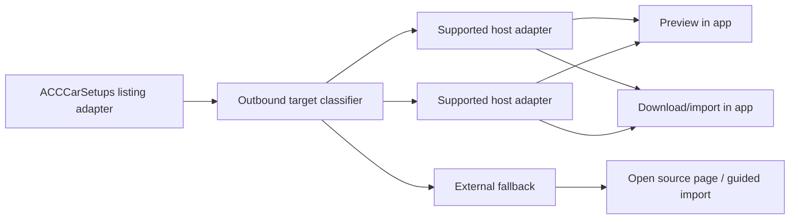

# ACCCarSetups Integrated Experience Strategy

## Purpose

This document describes how to support **ACCCarSetups** with a **smooth, integrated user experience** even though ACCCarSetups is not a source-native setup host.

The key insight from the completed verification work is:

- **ACCCarSetups is valuable as a discovery catalog**
- **ACCCarSetups is not reliable as a direct preview/download source**
- many rows point to **third-party destinations**

So the correct strategy is **not** “build one more normal source adapter”.  
The correct strategy is to treat ACCCarSetups as a **discovery router** plus a **downstream-host adapter system**.

## Why the original v1 implementation deferred it

From the verification report:

1. ACCCarSetups has good public breadth for browsing by car and track.
2. Its rows often point to:
   - third-party setup product pages
   - videos
   - blank/unusable links
3. No verified stable first-party JSON/file download flow was found on ACCCarSetups itself.
4. No practical first-party preview path was found.

That means a normal adapter shaped like:

- list
- preview
- download

does **not** fit this source.

## Product goal

Users should still experience ACCCarSetups as a **high-quality integrated tab**, not as a dead-end outbound link list.

The UX goal is:

1. browse ACCCarSetups results by car and track inside the app
2. understand immediately what each row can do
3. preview or import where supported
4. fall back gracefully to an in-app or external handoff where full automation is not possible

## Core strategy

Split the problem into **two adapter layers**.

### Layer 1: ACCCarSetups listing adapter

Responsibilities:

- fetch ACCCarSetups listing pages
- normalize row metadata
- extract the outbound target for each row
- classify the outbound target

This layer is **discovery only**.

### Layer 2: Downstream host adapters

Responsibilities:

- preview the setup if possible
- download or generate the setup JSON if possible
- normalize host-specific metadata and errors

This layer is where actual setup acquisition happens.

## Mental model

Think of ACCCarSetups as a **catalog of references**, not a repository.

## What the app should present to users

Every ACCCarSetups row should surface a **capability state**.

Recommended states:

1. **Preview + Download**
2. **Download only**
3. **Open source page**
4. **Unsupported**

This gives users a consistent integrated UI while remaining honest about what is technically possible.

## Row normalization model

The ACCCarSetups listing adapter should normalize each row into something like:

- `id`
- `sourceId = acccarsetups`
- `name`
- `displayName`
- `carId`
- `trackId`
- `sourcePageUrl`
- `outboundUrl`
- `author?`
- `lapTime?`
- `publishedAt?`
- `rankingLabel?`
- `targetHost`
- `capability`
- `capabilityReason`
- `downstreamAdapterId?`
- `sourceMetadata`

Important distinction:

- `sourcePageUrl` = ACCCarSetups page/listing context
- `outboundUrl` = actual target to be resolved by host adapters

## Outbound target classification

After scraping each row, classify the outbound target into one of these categories:

1. **Supported third-party setup host**
2. **Potential future supported host**
3. **Video / content page**
4. **Blank / missing target**
5. **Unknown external page**

This classifier is critical because it decides what the UI can offer.

## Recommended capability mapping

| Target class | App behavior |
| --- | --- |
| Supported third-party setup host | Full integrated flow via host adapter |
| Future supported host | Show row, mark as external-only for now |
| Video/content page | Open source page; no preview/import |
| Blank/missing | Show unavailable state |
| Unknown external page | Open source page; optional guided import |

## Recommended phased implementation

### Phase 1: Discovery-first ACCCarSetups integration

Deliver:

- ACCCarSetups listing support in the app
- normalized rows for selected car + track
- outbound target extraction
- capability classification
- clear row actions based on capability

This already gives users a much better experience than a plain browser hop.

### Phase 2: Support the highest-frequency outbound hosts

After observing real ACCCarSetups rows, identify the top 1–3 downstream domains it links to most often.

For each chosen host, build a dedicated host adapter that can provide:

- preview if possible
- download/import if possible
- host-specific metadata mapping

This is where ACCCarSetups starts to feel genuinely integrated for common cases.

### Phase 3: Guided fallback import

For unsupported outbound destinations, provide a guided flow:

1. open the source page
2. explain that the setup must be downloaded from the source site
3. offer a one-click “Import downloaded file into current track” action afterward

This preserves a smooth user journey even without full automation.

## Recommended UX details

### In the list

Each ACCCarSetups row should show:

- setup name
- source label
- author if available
- lap time if available
- published date if available
- capability badge

Examples:

- `Preview + Download`
- `Download only`
- `Open externally`
- `Unavailable`

### On row action

If supported by a downstream host adapter:

- open preview in the existing preview/editor area
- allow import/download directly into the selected track folder

If unsupported:

- open the source page
- preserve user position in the ACCCarSetups list
- offer a guided import path on return

### On double-click

Recommended behavior:

- if preview is available, open preview
- else if direct download is available, trigger download flow
- else open source page

## Architecture recommendation

Add an adapter split like this:

### ACCCarSetups discovery adapter

Methods conceptually equivalent to:

- `searchListings(carId, trackId)`
- `normalizeListingRow(rawRow)`
- `classifyOutboundTarget(outboundUrl)`

### Downstream host adapter contract

Methods conceptually equivalent to:

- `supports(url)`
- `getCapability(url)`
- `getPreview(url)`
- `downloadSetup(url)`
- `normalizeMetadata(url, previewOrDetailPayload)`

## Why this is the right architecture

Without this split, the code will either:

1. pretend ACCCarSetups is a normal source and fail often, or
2. become a pile of special cases inside one adapter

With this split:

- ACCCarSetups stays responsible for discovery
- downstream adapters stay responsible for actual content retrieval
- new hosts can be added incrementally

## Caching strategy

Recommended cache boundaries:

1. cache ACCCarSetups listing results per `(car, track)`
2. cache outbound-target classification per row
3. cache downstream host previews/download metadata separately

Do **not** mix discovery cache and downstream-host cache into one payload.

## Ranking strategy

ACCCarSetups only has **weak** ranking value on its own.

Recommended behavior:

- use ACCCarSetups-native row metadata where available
- if a downstream host exposes better ranking/popularity, prefer that only after host resolution
- otherwise fall back to alphabetical/date/lap-time style ordering

Do not promise a universally meaningful “best” ranking from ACCCarSetups itself.

## Risks

1. **Many-host integration problem**  
   Supporting ACCCarSetups well means supporting multiple outbound target types.

2. **Fragile outbound assumptions**  
   The site may change row structure or outbound-link patterns.

3. **Uneven capabilities**  
   Some rows will never support preview/download.

4. **Potential legal/policy differences downstream**  
   Each target host may have different expectations and constraints.

## Recommended immediate next step

Build the **ACCCarSetups discovery adapter first**, but do **not** try to solve every downstream target immediately.

The best next slice is:

1. load ACCCarSetups listings for selected car + track
2. extract/classify outbound targets
3. implement capability badges and row actions
4. add one supported downstream host adapter for the most common validated target type

That yields the best balance between:

- user-visible improvement
- architectural correctness
- incremental delivery

## Acceptance criteria for the follow-up agent

The first implementation pass should be considered good if:

1. ACCCarSetups results load inside the app for supported car/track mappings.
2. Each row exposes a capability state derived from the outbound target.
3. Supported downstream targets can be previewed/downloaded inside the app.
4. Unsupported targets degrade cleanly to external open + guided import.
5. The architecture clearly separates:
   - ACCCarSetups discovery
   - downstream host resolution
   - preview/download/import behavior

## Summary

To make ACCCarSetups feel smooth for users:

- **do not model it as a normal remote setup host**
- **model it as a discovery catalog plus downstream host adapters**
- **surface capability honestly**
- **fully integrate common downstream targets**
- **gracefully hand off unsupported ones**

That is the only realistic path to a polished integrated experience without hiding the true structure of the source.
