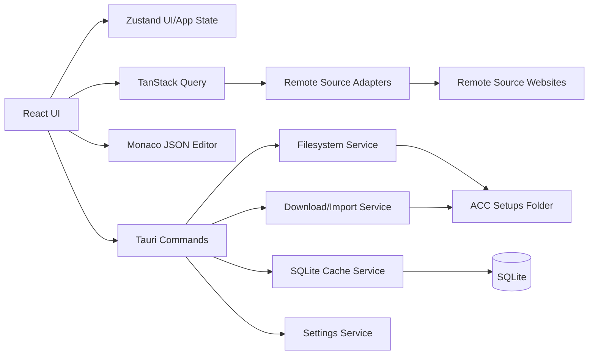

# ACC Setup Manager Implementation Plan

## Status
Created on 2026-08-21 from the current PRD and follow-up planning decisions.

## Planning Decisions Locked
1. **Platform target:** Windows-only for v1.
2. **Desktop framework:** Recommend **Tauri 2 + React + TypeScript**.
3. **Architecture bias:** Heavier foundation for long-term growth, not the fastest throwaway MVP.
4. **Remote sources:** Desktop app integrates sources directly in v1, behind adapters that could move to a backend later.
5. **Dependencies:** Use proven libraries where they materially reduce risk or effort.
6. **Testing:** Unit + integration coverage for core logic, plus light UI end-to-end smoke coverage.
7. **Setup model:** Treat setup contents as generic JSON in v1.
8. **Delivery shape:** Include release automation, installers, and GitHub Releases-based auto-update in v1.
9. **Open source:** Repository should include developer-friendly manual build/publish workflows.

## Recommended Stack
### Core app
- **Tauri 2**
- **Rust** for native/system services
- **React 18 + TypeScript + Vite** for the UI

### UI and state
- **Mantine** for app shell, tabs, menus, modal/dialog patterns, notifications, scroll areas
- **react-resizable-panels** for the file-explorer multi-pane layout
- **react-virtuoso** for large, smooth local/remote setup lists
- **Zustand** for in-memory UI state and undo/redo state
- **TanStack Query** for remote source query orchestration and cache invalidation

### Editing and validation
- **Monaco Editor** for JSON editing/preview
- Native `JSON.parse` plus a thin validation layer for syntax-only save validation

### Persistence and data
- **SQLite** in the app data directory, owned by the Rust backend
- Rust-side services exposed to the frontend through Tauri commands

### Testing
- **Vitest** for unit tests
- **React Testing Library** for UI/unit integration tests
- **Playwright** for a small Windows smoke suite

## Why Tauri Instead of Electron
Tauri is the better fit here because the app is filesystem-heavy, Windows-first, open source, and likely modest in UI complexity compared to a full browser-based desktop shell. It gives:

- lower memory footprint
- strong native integration
- straightforward GitHub Releases updater support
- a clean split between native filesystem logic and the React UI

Electron would still work, but it would be heavier without giving a strong benefit for this product.

## Architecture Overview


## Major Subsystems
### 1. Native shell and system services
Rust/Tauri should own:

- Windows path detection
- filesystem scanning
- file read/write/create/rename/delete/import
- recycle-bin integration
- SQLite access
- updater wiring
- secure local path validation

This keeps OS-sensitive logic out of the React app and makes later platform expansion easier.

### 2. Explorer UI
The React app should own:

- pane layout
- list rendering
- selection state
- context menus
- toolbar actions
- source tabs
- view switching between remote list and editor/preview

### 3. Local setup editing
The editor subsystem should support:

- editable local JSON
- read-only remote preview
- dirty state tracking
- syntax validation
- explicit save
- editor-level undo/redo

### 4. Remote source adapter layer
Each source should implement the same contract:

- list setups for `(car, track)`
- fetch metadata
- fetch preview JSON when supported
- fetch/download raw setup content
- map source-specific fields to a normalized app model

This layer must remain separate from the UI and separate from cache persistence.

### 5. Cache and offline behavior
The app should persist remote metadata and preview payloads per `(source, car, track)` with a 24-hour TTL. The UI should know whether data is:

- fresh
- stale but usable
- loading
- unavailable

### 6. Undo/redo operation layer
App-level undo/redo should operate on reversible commands for:

- create
- rename
- delete

For v1, delete should **not** immediately become a permanent OS-level delete if undo is required. The safest design is:

1. move deleted files into an app-managed session staging area
2. remove them from the live ACC folder immediately
3. restore from staging on undo
4. finalize to the Windows Recycle Bin when the action falls out of undo history or when the app exits

This preserves both undo semantics and “go to trash if possible” semantics.

## Recommended Repository Structure
```text
ACCSetupManager/
  .agents/
    prd.md
    implementation-plan.md
  src/
    app/
    components/
    features/
      explorer/
      local-setups/
      remote-sources/
      setup-editor/
      settings/
    lib/
    state/
    types/
    test/
  src-tauri/
    src/
      commands/
      services/
      models/
      cache/
      updater/
  public/
  .github/
    workflows/
```

## Domain Model
### Local models
- `Car`
  - `id`
  - `displayName`
- `Track`
  - `id`
  - `displayName`
  - `carId`
- `LocalSetup`
  - `id`
  - `fileName`
  - `displayName`
  - `absolutePath`
  - `carId`
  - `trackId`
  - `sourceLabel?`
  - `lastModifiedAt`

### Remote models
- `RemoteSource`
  - `id`
  - `name`
  - `baseUrl`
  - `supportsPreview`
- `RemoteSetup`
  - `id`
  - `sourceId`
  - `name`
  - `displayName`
  - `carId`
  - `trackId`
  - `sourcePageUrl`
  - `downloadUrl?`
  - `previewKey?`
  - `updatedAt?`
  - `rankingValue?`
  - `rankingLabel?`
  - `author?`
  - `sourceMetadata`

### Editor models
- `SetupDocument`
  - `kind: local | remote`
  - `id`
  - `title`
  - `content`
  - `readOnly`
  - `dirty`
  - `sourceLabel`

## Persistence Plan
### SQLite tables
Recommended initial tables:

1. `settings`
   - key/value store for app settings such as manual root override
2. `remote_cache_entries`
   - `source_id`
   - `car_id`
   - `track_id`
   - `fetched_at`
   - `expires_at`
   - `stale`
   - `payload_json`
3. `remote_preview_cache`
   - `source_id`
   - `preview_key`
   - `fetched_at`
   - `payload_json`
4. `download_history`
   - useful for debugging import collisions and future product extensions

### What should remain in memory only
- selected car
- selected track
- selected local setup
- per-source selected remote setup
- pane scroll positions
- back-to-list state
- app-level undo/redo stack

This matches the product decision that those UI states do not need to survive restarts.

## Remote Source Strategy
### Stage 1: source verification spike
Before building full UI integrations, run a short spike to verify:

1. robots/terms are not obviously incompatible with the planned use
2. list pages are stable enough to parse
3. setup files can be downloaded without login
4. preview is possible or clearly impossible
5. car/track mapping is broad enough for MVP

### Candidate order
1. **ACCCarSetups**
2. **Parc Ferme**
3. **Simply Lovely Setups**

### MVP recommendation
Ship with **one source first** if it has enough breadth and technical reliability. Add the second source only if the first is too thin or unstable.

### Adapter contract
Each adapter should expose methods conceptually equivalent to:

- `searchSetups(carId, trackId)`
- `getSetupPreview(remoteSetupId)`
- `downloadSetup(remoteSetupId)`
- `normalizeRanking(remoteSetup)`

The UI should never know source-specific scraping details.

## Implementation Phases
### Phase 0 - Bootstrap and project skeleton
Deliverables:
- Tauri + React + TypeScript app scaffold
- base lint/typecheck/test scripts
- Mantine app shell
- basic GitHub Actions CI
- app configuration and environment conventions

Exit criteria:
- app launches locally
- CI validates install, lint, typecheck, and tests

### Phase 1 - Native filesystem foundation
Deliverables:
- detect default Windows ACC setups path
- manual root override setting
- filesystem scanning for cars/tracks/setups
- file read/write/create/rename operations
- path validation and error mapping

Exit criteria:
- app can reliably read an ACC setup tree from disk

### Phase 2 - Explorer UI and local browsing
Deliverables:
- four-pane layout
- cars/tracks/local setups list rendering
- selection model
- local filters and sorting
- toolbars and context menus

Exit criteria:
- user can browse cars, tracks, and local setups smoothly

### Phase 3 - Editor, local CRUD, import, and undo/redo
Deliverables:
- Monaco-based JSON editor
- create flow with filename prompt
- explicit save with syntax validation
- rename and delete actions
- drag-and-drop import
- file-picker import
- app-level undo/redo for create/rename/delete

Exit criteria:
- all local file management scenarios work end to end

### Phase 4 - Remote source infrastructure and caching
Deliverables:
- source tab framework
- normalized remote models
- SQLite cache layer with TTL
- stale/offline cache handling
- refresh action bypassing cache

Exit criteria:
- adapter results can be loaded, cached, invalidated, and displayed consistently

### Phase 5 - First remote source integration
Deliverables:
- first production adapter
- metadata list display
- remote row selection
- preview flow if supported
- row-level download action
- preview-level download action
- filename collision flow

Exit criteria:
- one real source is usable in daily workflow

### Phase 6 - Additional source(s) if needed
Deliverables:
- second adapter only if justified by phase-5 findings
- adapter hardening
- source-specific mapping fixes

Exit criteria:
- source coverage is good enough for v1

### Phase 7 - Release pipeline and auto-update
Deliverables:
- versioning approach
- GitHub Releases publishing workflow
- updater configuration
- Windows installer artifact publishing
- Linux/macOS workflow groundwork intentionally omitted from v1 scope

Exit criteria:
- a maintainer can trigger a workflow and publish a releasable Windows build with updater metadata

### Phase 8 - Hardening, docs, and OSS readiness
Deliverables:
- README
- contributor/dev setup docs
- architecture notes
- issue templates if desired
- better error messages and empty states
- smoke-test pass on release flow

Exit criteria:
- repository is understandable and usable by outside contributors

## Release and Workflow Plan
### CI workflow
`ci.yml`

Runs on push and pull request:
- dependency install
- lint
- typecheck
- unit/integration tests

### Manual build workflow
`build-release.yml`

Triggered by `workflow_dispatch` with inputs such as:
- version
- draft vs publish
- include updater artifacts

Behavior:
- builds Windows artifacts
- creates or updates a GitHub Release
- uploads binaries and updater metadata

### Future workflow extension
When cross-platform support is revived, expand the workflow matrix for:
- macOS
- Linux AppImage
- Linux `.deb`

## Auto-Update Plan
Use the Tauri updater with GitHub Releases as the canonical source.

Recommended behavior:
- check for updates at startup
- allow manual “Check for updates”
- show release notes in-app when available
- only offer updates from published stable releases

## Testing Strategy
### Unit tests
Focus on:
- source normalization
- cache TTL logic
- filename conflict handling
- sort/filter behavior
- undo/redo command behavior

### Integration tests
Focus on:
- filesystem command boundaries
- settings persistence
- cache reads/writes
- import/download flows

### UI smoke tests
Focus on:
- app launch
- select car -> select track -> see setups
- create setup -> edit -> save
- delete setup -> undo
- open remote source -> preview/download if source is available in test mode

## Risk Register
1. **Remote source instability**  
   HTML structures may change without notice.

2. **Legal/terms ambiguity**  
   Some sources may be technically parseable but not good citizens to automate against.

3. **Undo vs recycle-bin behavior**  
   This needs deliberate implementation, not a naive delete.

4. **Remote setup preview variability**  
   Some sources may allow download but not preview.

5. **Ranking inconsistency**  
   Sorting by ranking may be absent or uneven across sources.

## Explicit Non-Goals for v1
- cross-platform Linux/macOS support
- custom user-defined sources
- account systems
- hosted analytics/telemetry
- custom ranking backend
- typed ACC schema enforcement

## Post-v1 Roadmap
1. Restore the cross-platform goal with Windows abstractions already in place.
2. Add more source adapters behind the same contract.
3. Consider typed ACC setup understanding and richer structured editing.
4. Add optional persistent workspace state if users ask for it.
5. Add deeper comparison tools between setups.

## Recommended Immediate Next Step
Implement **Phase 0 + Phase 1**, then run the **remote source verification spike** before committing to the first real adapter.
