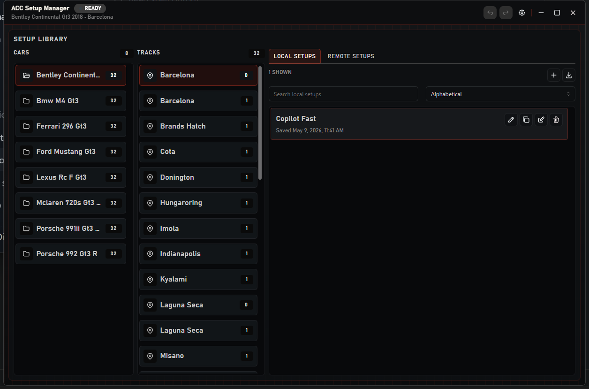
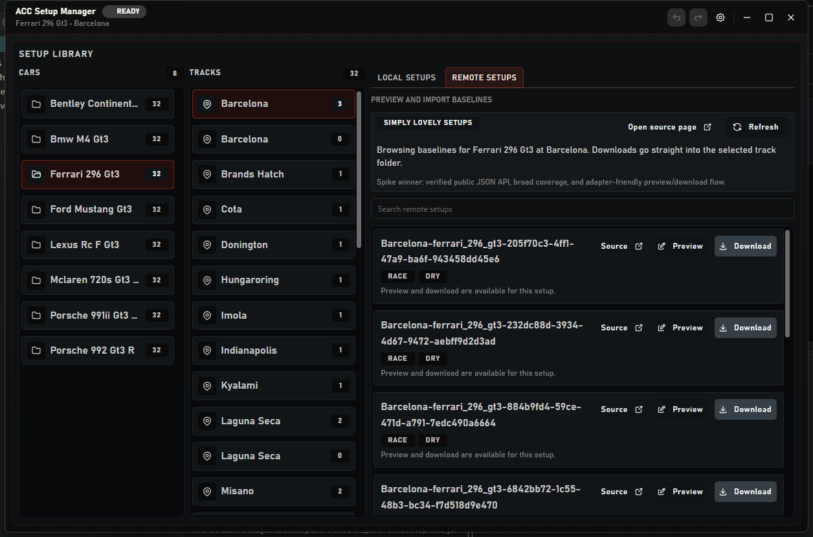

# ACC Setup Manager

[](LICENSE)

A Windows desktop app for browsing, editing, and organizing **Assetto Corsa Competizione** setup files.



It reads your existing ACC setup folders directly — nothing to import, nothing to convert. Cars and
tracks are detected automatically, setups load on demand, and the editor writes the same `.json`
files ACC itself uses.

## Features

- Tauri 2 + React desktop shell (Windows-first, with a system tray)
- Automatic detection of the default ACC setups folder, with a manual override
- Three-column browser for cars, tracks, and setups, with on-demand loading
- Structured setup editor with a raw JSON fallback and explicit save
- Create, rename, delete, import, and duplicate setups
- Session-scoped undo/redo for create, rename, and delete
- Remote setup browser with preview and one-click download into the selected track folder
- SQLite-backed local settings plus a cached remote list, with stale-data fallback



## Remote setups

The app currently integrates one remote source:

| Source | Status |
| --- | --- |
| [Simply Lovely Setups](https://www.simplylovelysetups.com/) | List, preview, and download |
| ACCCarSetups | Deferred |
| Parc Ferme | Deferred |

The Simply Lovely adapter reads the site's public, site-bundled API key at runtime, calls the same JSON
API the website uses, and converts the payload into the `.json` files ACC expects. No credentials are
shipped with the app.

## Download

Prebuilt installers (`.exe`, `.msi`) are attached to [Releases](../../releases). If there is no release
yet, build from source with the steps below.

Builds are not code-signed, so Windows SmartScreen may warn the first time you run the installer.

## Requirements

- Windows 10/11
- Node.js 22+
- Rust 1.77+
- [Tauri prerequisites](https://tauri.app/start/prerequisites/) (WebView2, MSVC build tools)

## Development

```powershell
npm install          # install dependencies
npm run tauri:dev    # run the full desktop app
npm run dev          # frontend only, on http://localhost:1420
```

### Scripts

| Script | Purpose |
| --- | --- |
| `npm run dev` | Vite dev server on port 1420 |
| `npm run tauri:dev` | Full desktop app in Tauri |
| `npm run build` | Type-check and build the frontend |
| `npm run lint` | Run Oxlint |
| `npm run test` | Run Vitest |
| `npm run e2e` | Run Playwright tests |
| `cargo check --manifest-path src-tauri\Cargo.toml` | Validate the Rust backend |

### Project layout

```text
src/                 React frontend
  App.tsx
  lib/               setup editor, remote sources, Tauri bridge
  state/             Zustand store
  types/
src-tauri/           Rust backend
  src/
    commands.rs      Tauri command surface
    models.rs
    services/        filesystem, remote sources, settings, undo, baselines
    state.rs
docs/                GitHub Pages site and screenshots
```

## How it works

- The app works against the ACC setups folder in place and **never applies a setup in-game**.
- Files are validated as JSON syntax only, matching the original scope of the project.
- Deletes stage a restore copy for the current session so undo keeps working; the original file is
  moved out of the ACC folder, not destroyed immediately.
- Remote downloads are pretty-printed and written into the selected car/track folder.
- The only network access is to the remote setup source you open.

## Status

This is a personal project, built for my own use and shared as-is. It is not actively maintained, and
there is no roadmap or support commitment. Use it at your own risk — but feel free to fork it.

## License

[MIT](LICENSE) © 2026 Diogo Jesus

Not affiliated with Kunos Simulazioni or 505 Games. Assetto Corsa Competizione is a trademark of its
respective owners.
